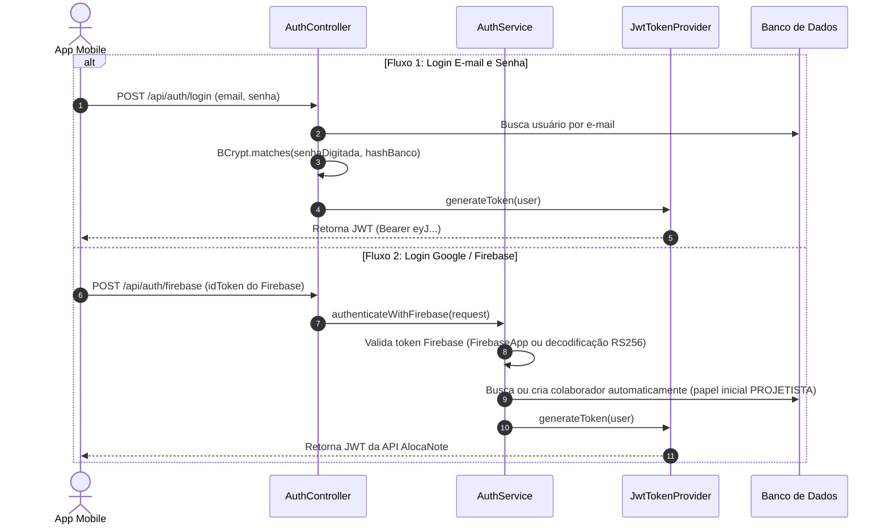
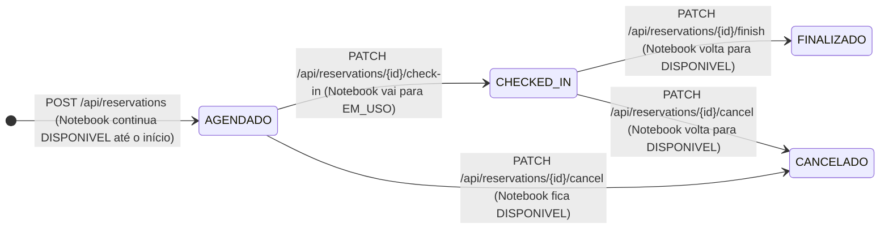

# 🎓 Guia Definitivo de Estudos: Apresentação do Backend AlocaNote

Este guia foi elaborado sob medida para você dominar todos os aspectos técnicos, arquiteturais e de regras de negócio do backend do **AlocaNote** (API Spring Boot 3 + Java 21) e se destacar na apresentação para o professor e a banca avaliadora.

---

## 🧭 1. Resumo Executivo do Projeto (O Que Responder em 1 Minuto)

> **O que é o AlocaNote?**  
> *"O AlocaNote é uma API REST corporativa desenvolvida para solucionar um problema real de gestão e alocação de equipamentos (3 notebooks) entre 8 colaboradores em uma loja de móveis planejados em João Pessoa/PB. Ele substitui um processo informal e falho realizado via grupos de WhatsApp por um ecossistema seguro, auditável e automatizado, com rastreamento em tempo real do estado dos aparelhos, prevenção matemática de choque de horários e registro de check-in/devolução com geolocalização e fotos."*

### 🛠️ Stack Tecnológica e Justificativas de Escolha

| Tecnologia | Função no Projeto | Por que foi escolhida? (Argumento para o Professor) |
| :--- | :--- | :--- |
| **Java 21** | Linguagem Principal | Versão LTS moderna com alta performance, suporte a Records (usados em DTOs), Pattern Matching e novos recursos da JVM. |
| **Spring Boot 3.3.4** | Framework Base | Padrão corporativo consolidado para microsserviços e APIs REST; simplifica configuração com injeção de dependência e ecossistema robusto. |
| **Spring Security 6 + JWT** | Autenticação & Autorização | Garante comunicação *stateless* (sem sessão em memória no servidor), escalável para apps mobile, com controle granular de perfis via Bearer Token. |
| **Firebase Admin SDK** | Autenticação Social | Permite login seguro com a Conta Google dos colaboradores sem que a API precise armazenar credenciais sensíveis de terceiros. |
| **Spring Data JPA / Hibernate**| Camada de Persistência | Abstrai comandos SQL brutos em operações orientadas a objetos, agilizando consultas complexas e relacionamentos entre entidades. |
| **Flyway** | Versionamento de Banco de Dados | Garante migrações de esquema controladas, reprodutíveis e versionadas em código (`V1` a `V5`), prevenindo inconsistências entre ambientes. |
| **PostgreSQL (Neon) & H2** | Bancos de Dados | PostgreSQL em nuvem (*Serverless*) para ambiente real/produção e H2 em arquivo/memória para agilidade em testes e desenvolvimento local. |
| **JUnit 5 + Mockito** | Testes Unitários e Integração | Valida o isolamento das regras de negócio (serviços e controladores) sem depender de banco de dados ativo. |

---

## 🏛️ 2. Arquitetura em Camadas (Layered Architecture)

O backend segue estritamente a arquitetura em camadas padrão de aplicações corporativas Spring Boot, garantindo o princípio da responsabilidade única (Single Responsibility Principle - SOLID):

```mermaid
flowchart TD
    Client["📱 App Mobile (React Native / Expo)"] -->|Requisição HTTP / JSON + Bearer Token| SecurityFilter["🛡️ SecurityFilter (OncePerRequestFilter)"]
    SecurityFilter -->|Contexto Autenticado| Controller["🎮 Controller (@RestController)"]
    Controller -->|DTO de Entrada Validados (@Valid)| Service["⚙️ Service (@Service)"]
    Service -->|Regras de Negócio & Transações (@Transactional)| Repository["💾 Repository (Spring Data JPA)"]
    Repository -->|Mapeamento Objeto-Relacional (ORM)| Database[("🗄️ PostgreSQL / H2 Database")]
    Service -->|DTO de Saída (Records)| Controller
    Controller -->|HTTP 200/201/400/404 + JSON| Client
```

### Detalhamento das Camadas no Código:

1. **`controller/`**: Porta de entrada das requisições HTTP.
   - Exemplos: [`ReservationController`](file:///C:/Users/lanus/Documents/SISTEMAS%20PARA%20INTERNET/5%20SEMESTRE/Programa%C3%A7%C3%A3o%20para%20dispositivos%20m%C3%B3veis/alocanote/alocanote-backend/api/src/main/java/com/alocanote/api/controller/ReservationController.java), [`AuthController`](file:///C:/Users/lanus/Documents/SISTEMAS%20PARA%20INTERNET/5%20SEMESTRE/Programa%C3%A7%C3%A3o%20para%20dispositivos%20m%C3%B3veis/alocanote/alocanote-backend/api/src/main/java/com/alocanote/api/controller/AuthController.java), [`NotebookController`](file:///C:/Users/lanus/Documents/SISTEMAS%20PARA%20INTERNET/5%20SEMESTRE/Programa%C3%A7%C3%A3o%20para%20dispositivos%20m%C3%B3veis/alocanote/alocanote-backend/api/src/main/java/com/alocanote/api/controller/NotebookController.java).
   - **Regra de ouro:** O Controller **nunca** contém lógica de negócio ou queries SQL. Ele apenas recebe o DTO, valida com `@Valid`, chama o `Service` correspondente e retorna uma resposta HTTP (`ResponseEntity`).
2. **`service/`**: O "coração" da aplicação.
   - Exemplos: [`ReservationService`](file:///C:/Users/lanus/Documents/SISTEMAS%20PARA%20INTERNET/5%20SEMESTRE/Programa%C3%A7%C3%A3o%20para%20dispositivos%20m%C3%B3veis/alocanote/alocanote-backend/api/src/main/java/com/alocanote/api/service/ReservationService.java), [`AuthService`](file:///C:/Users/lanus/Documents/SISTEMAS%20PARA%20INTERNET/5%20SEMESTRE/Programa%C3%A7%C3%A3o%20para%20dispositivos%20m%C3%B3veis/alocanote/alocanote-backend/api/src/main/java/com/alocanote/api/service/AuthService.java), [`NotebookService`](file:///C:/Users/lanus/Documents/SISTEMAS%20PARA%20INTERNET/5%20SEMESTRE/Programa%C3%A7%C3%A3o%20para%20dispositivos%20m%C3%B3veis/alocanote/alocanote-backend/api/src/main/java/com/alocanote/api/service/NotebookService.java).
   - Onde ficam as validações (ex: choque de horários, se o equipamento está em manutenção, se o usuário pode cancelar aquela reserva) e o controle transacional com `@Transactional`.
3. **`repository/`**: Comunicação com o banco.
   - Exemplos: [`ReservationRepository`](file:///C:/Users/lanus/Documents/SISTEMAS%20PARA%20INTERNET/5%20SEMESTRE/Programa%C3%A7%C3%A3o%20para%20dispositivos%20m%C3%B3veis/alocanote/alocanote-backend/api/src/main/java/com/alocanote/api/repository/ReservationRepository.java), [`UserRepository`](file:///C:/Users/lanus/Documents/SISTEMAS%20PARA%20INTERNET/5%20SEMESTRE/Programa%C3%A7%C3%A3o%20para%20dispositivos%20m%C3%B3veis/alocanote/alocanote-backend/api/src/main/java/com/alocanote/api/repository/UserRepository.java).
   - Herdam de `JpaRepository<Entidade, TipoId>`, fornecendo métodos CRUD automáticos (`findById`, `save`, `delete`) e consultas JPQL especializadas via anotação `@Query`.
4. **`model/entity/`**: Entidades persistentes do banco (`@Entity`, `@Table`).
   - Mapeadas com Jakarta Persistence (`User`, `Notebook`, `Reservation`, `Location`).
5. **`dto/` (Data Transfer Objects)**:
   - Implementados com **Java Records** (recurso moderno do Java que cria classes imutáveis com getters automáticos, `equals`, `hashCode` e `toString`).
   - **Por que usamos DTOs?** Para não expor as entidades do banco diretamente na API. Evita vazamento de dados sensíveis (ex: senha do usuário), protege contra ataques de *Mass Assignment* e desacopla o formato do JSON enviado ao cliente da estrutura interna do banco.
6. **`exception/`**: Tratamento centralizado de erros.
   - [`GlobalExceptionHandler`](file:///C:/Users/lanus/Documents/SISTEMAS%20PARA%20INTERNET/5%20SEMESTRE/Programa%C3%A7%C3%A3o%20para%20dispositivos%20m%C3%B3veis/alocanote/alocanote-backend/api/src/main/java/com/alocanote/api/exception/GlobalExceptionHandler.java) com `@RestControllerAdvice`.
   - Intercepta qualquer exceção lançada na aplicação (ex: `BusinessException`, `ResourceNotFoundException`) e a converte em um JSON padronizado (`StandardError`) com status HTTP correto (400, 404, 500).

---

## 🔒 3. Segurança e Fluxo de Autenticação Híbrida

Um dos pontos mais avançados do seu backend é a **Autenticação Híbrida Dual**: a API aceita tanto login tradicional (e-mail/senha) quanto autenticação social integrada ao Firebase (Google Sign-In).



### Como as Requisições Seguintes São Protegidas?
1. Toda requisição a rotas protegidas envia o header: `Authorization: Bearer <TOKEN_JWT>`.
2. A classe [`SecurityFilter`](file:///C:/Users/lanus/Documents/SISTEMAS%20PARA%20INTERNET/5%20SEMESTRE/Programa%C3%A7%C3%A3o%20para%20dispositivos%20m%C3%B3veis/alocanote/alocanote-backend/api/src/main/java/com/alocanote/api/security/SecurityFilter.java) estende `OncePerRequestFilter`:
   - Extrai o token do header.
   - Chama [`JwtTokenProvider.validateToken()`](file:///C:/Users/lanus/Documents/SISTEMAS%20PARA%20INTERNET/5%20SEMESTRE/Programa%C3%A7%C3%A3o%20para%20dispositivos%20m%C3%B3veis/alocanote/alocanote-backend/api/src/main/java/com/alocanote/api/security/JwtTokenProvider.java#L76-L91), que verifica a assinatura criptográfica HMAC-256 e data de expiração.
   - Carrega os dados do usuário via [`UserDetailsServiceImpl`](file:///C:/Users/lanus/Documents/SISTEMAS%20PARA%20INTERNET/5%20SEMESTRE/Programa%C3%A7%C3%A3o%20para%20dispositivos%20m%C3%B3veis/alocanote/alocanote-backend/api/src/main/java/com/alocanote/api/security/UserDetailsServiceImpl.java).
   - Injeta o objeto `UsernamePasswordAuthenticationToken` no `SecurityContextHolder`.
3. Dessa forma, qualquer Controller pode injetar `@AuthenticationPrincipal UserDetails userDetails` para saber instantaneamente quem é o colaborador que está fazendo a requisição.

---

## 💡 4. As Regras de Negócio Críticas (O que o Professor Vai Querer Ver no Código)

### Regra 1: Prevenção Matemática de Conflito de Horários
Se o professor perguntar: *"Como vocês garantiram que dois colaboradores não reservem o mesmo notebook no mesmo horário?"*, aponte para o [`ReservationRepository.java`](file:///C:/Users/lanus/Documents/SISTEMAS%20PARA%20INTERNET/5%20SEMESTRE/Programa%C3%A7%C3%A3o%20para%20dispositivos%20m%C3%B3veis/alocanote/alocanote-backend/api/src/main/java/com/alocanote/api/repository/ReservationRepository.java#L22-L31):

```java
@Query("SELECT r FROM Reservation r WHERE r.notebook.id = :notebookId " +
       "AND r.status IN :statuses " +
       "AND (r.departureDateTime < :returnDateTime AND r.returnDateTime > :departureDateTime)")
List<Reservation> findConflictingReservations(
        @Param("notebookId") Long notebookId,
        @Param("departureDateTime") LocalDateTime departureDateTime,
        @Param("returnDateTime") LocalDateTime returnDateTime,
        @Param("statuses") List<ReservationStatus> statuses
);
```

#### Explicação Técnica:
Esta query aplica a **Lógica de Interseção de Intervalos de Allen**:
- Dois intervalos temporais $[A_{inicio}, A_{fim}]$ e $[B_{inicio}, B_{fim}]$ se sobrepõem **se, e somente se**:
  $$\text{Início}_A < \text{Fim}_B \quad \text{E} \quad \text{Fim}_A > \text{Início}_B$$
- O sistema filtra apenas reservas com status ativos (`AGENDADO` e `CHECKED_IN`). Reservas `FINALIZADO` ou `CANCELADO` são ignoradas pela verificação, liberando o equipamento.

### Regra 2: Ciclo de Vida da Reserva e Sincronização do Notebook
Veja como os estados se alternam no [`ReservationService`](file:///C:/Users/lanus/Documents/SISTEMAS%20PARA%20INTERNET/5%20SEMESTRE/Programa%C3%A7%C3%A3o%20para%20dispositivos%20m%C3%B3veis/alocanote/alocanote-backend/api/src/main/java/com/alocanote/api/service/ReservationService.java):



- **Ao agendar:** Valida se o notebook não está com status `MANUTENCAO`.
- **Ao fazer Check-in:** A reserva passa para `CHECKED_IN` e o notebook muda para `EM_USO`. Salva carimbo de data/hora (`checkInAt`), tipo de local (`LOJA`, `EXTERNO`), endereço e coordenadas GPS (latitude/longitude).
- **Ao Finalizar (Check-out):** A reserva passa para `FINALIZADO` e o notebook é imediatamente devolvido ao status `DISPONIVEL`. Permite salvar foto de devolução em Base64 ou URL (`returnPhotoUrl`).

### Regra 3: Controle de Posse e Privilégio Administrativo
No método `validarPosseReserva()` do [`ReservationService`](file:///C:/Users/lanus/Documents/SISTEMAS%20PARA%20INTERNET/5%20SEMESTRE/Programa%C3%A7%C3%A3o%20para%20dispositivos%20m%C3%B3veis/alocanote/alocanote-backend/api/src/main/java/com/alocanote/api/service/ReservationService.java#L272-L280):
- Um colaborador só pode visualizar detalhes específicos, fazer check-in, finalizar ou cancelar **as suas próprias reservas**.
- O usuário com perfil `ADMINISTRADOR` (ou o e-mail mestre `admin@alocanote.com`) tem privilégio de auditoria total: pode listar o histórico de todos os usuários (`GET /api/reservations/all`) e gerenciar qualquer reserva.

---

## 🗄️ 5. Banco de Dados, Migrações e Inicialização

### 1. Migrações Flyway (`resources/db/migration/`)
O Flyway executa scripts versionados automaticamente ao subir a aplicação:
- [`V1__criar_tabelas_iniciais.sql`](file:///C:/Users/lanus/Documents/SISTEMAS%20PARA%20INTERNET/5%20SEMESTRE/Programa%C3%A7%C3%A3o%20para%20dispositivos%20m%C3%B3veis/alocanote/alocanote-backend/api/src/main/resources/db/migration/V1__criar_tabelas_iniciais.sql): Cria as tabelas `tb_user`, `tb_notebook`, `locations` e `reservations`.
- [`V2__adicionar_notebook_na_reserva.sql`](file:///C:/Users/lanus/Documents/SISTEMAS%20PARA%20INTERNET/5%20SEMESTRE/Programa%C3%A7%C3%A3o%20para%20dispositivos%20m%C3%B3veis/alocanote/alocanote-backend/api/src/main/resources/db/migration/V2__adicionar_notebook_na_reserva.sql): Adiciona a chave estrangeira `notebook_id` na tabela de reservas.
- [`V3__adicionar_cep_e_dados_locais.sql`](file:///C:/Users/lanus/Documents/SISTEMAS%20PARA%20INTERNET/5%20SEMESTRE/Programa%C3%A7%C3%A3o%20para%20dispositivos%20m%C3%B3veis/alocanote/alocanote-backend/api/src/main/resources/db/migration/V3__adicionar_cep_e_dados_locais.sql): Cria suporte a CEP e insere locais padrões.
- [`V4__ajustar_autenticacao_firebase_email.sql`](file:///C:/Users/lanus/Documents/SISTEMAS%20PARA%20INTERNET/5%20SEMESTRE/Programa%C3%A7%C3%A3o%20para%20dispositivos%20m%C3%B3veis/alocanote/alocanote-backend/api/src/main/resources/db/migration/V4__ajustar_autenticacao_firebase_email.sql): Torna o telefone opcional e adiciona campos do Firebase (`firebase_uid`, `auth_provider`, `email_verified`).
- [`V5__ajustar_tamanho_foto_perfil.sql`](file:///C:/Users/lanus/Documents/SISTEMAS%20PARA%20INTERNET/5%20SEMESTRE/Programa%C3%A7%C3%A3o%20para%20dispositivos%20m%C3%B3veis/alocanote/alocanote-backend/api/src/main/resources/db/migration/V5__ajustar_tamanho_foto_perfil.sql): Expande a coluna para até 10MB para suportar uploads em Base64 diretamente do mobile.

### 2. Semeador Automático ([`DataInitializer.java`](file:///C:/Users/lanus/Documents/SISTEMAS%20PARA%20INTERNET/5%20SEMESTRE/Programa%C3%A7%C3%A3o%20para%20dispositivos%20m%C3%B3veis/alocanote/alocanote-backend/api/src/main/java/com/alocanote/api/config/DataInitializer.java))
Ao inicializar, a classe implementa `CommandLineRunner` e:
1. Cria ou sincroniza o usuário administrador padrão (`admin@alocanote.com` com senha criptografada via BCrypt `admin123`).
2. Semeia os 3 notebooks da empresa (Dell Inspiron 15, Dell Latitude 3420, Lenovo ThinkPad E14).
3. Semeia os locais de retirada iniciais (Loja, Casa de colega, etc.).
4. Sincroniza as sequências de auto-incremento de ID para evitar conflitos de chave primária.

---

## 🎯 6. Simulação de Perguntas da Banca (Perguntas & Respostas Ideais)

Abaixo estão as perguntas clássicas que professores de desenvolvimento de sistemas e programação para dispositivos móveis costumam fazer:

### ❓ Pergunta 1: *"Por que vocês usaram DTOs em formato de Record em vez de receber e retornar as entidades do JPA diretamente?"*
> **Sua Resposta:**  
> *"Utilizamos DTOs com Java Records por três motivos fundamentais:  
> 1. **Segurança:** Evitar exposição de dados sensíveis da entidade, como o hash da senha do colaborador na resposta da API, e impedir ataques de atribuição em massa (*Mass Assignment*).  
> 2. **Imutabilidade e Concisão:** O `record` do Java 21 cria uma estrutura de dados imutável, thread-safe e sem *boilerplate* (getters, setters e construtores desnecessários).  
> 3. **Desacoplamento:** O formato do contrato JSON consumido pelo nosso aplicativo mobile não fica amarrado à modelagem relacional das tabelas do banco de dados."*

---

### ❓ Pergunta 2: *"Como o Spring Security sabe quem é o usuário em cada requisição se a API é Stateless?"*
> **Sua Resposta:**  
> *"Nossa aplicação não mantém sessão HTTP em memória (`SessionCreationPolicy.STATELESS`). Em cada requisição que chega, nossa classe `SecurityFilter` intercepta a chamada antes do Spring DispatcherServlet. Ela lê o cabeçalho `Authorization: Bearer <token>`, extrai e valida a assinatura criptográfica do JWT usando o `JwtTokenProvider`. Se o token for válido, ela busca o usuário e injeta um `UsernamePasswordAuthenticationToken` no `SecurityContextHolder`. A partir daí, o Spring Security reconhece o usuário autenticado e seus papéis para aquela requisição específica."*

---

### ❓ Pergunta 3: *"E se dois colaboradores tentarem reservar o mesmo notebook para o mesmo dia e horário simultaneamente?"*
> **Sua Resposta:**  
> *"Nosso `ReservationService` executa o método anotado com `@Transactional`. Antes de salvar a reserva, consultamos o `ReservationRepository` através do método `findConflictingReservations`. Esse método executa uma query JPQL que checa a sobreposição de horários (início anterior ao fim agendado e término posterior ao início agendado) para reservas ativas (`AGENDADO` ou `CHECKED_IN`). Se a lista retornada não estiver vazia, o sistema cancela a operação e lança uma `BusinessException` com mensagem clara, retornando HTTP 400 (Bad Request) para o aplicativo mobile."*

---

### ❓ Pergunta 4: *"Como vocês tratam erros na API para o aplicativo não receber uma tela de erro em HTML ou crashar?"*
> **Sua Resposta:**  
> *"Temos uma classe centralizadora chamada `GlobalExceptionHandler` anotada com `@RestControllerAdvice`. Ela intercepta todas as exceções da aplicação, como `BusinessException` (violações de regras de negócio), `ResourceNotFoundException` (IDs inexistentes) e `MethodArgumentNotValidException` (campos obrigatórios vazios ou formatos inválidos). O handler empacota o erro no formato padronizado `StandardError`, contendo timestamp, código HTTP de status, descrição e mensagem amigável em JSON, facilitando a exibição de alertas no app mobile."*

---

### ❓ Pergunta 5: *"Qual a diferença entre o banco H2 e o PostgreSQL configurados no projeto?"*
> **Sua Resposta:**  
> *"O H2 é um banco relacional leve e embutido, perfeito para execução rápida de testes unitários e de integração (`src/test`) sem exigir dependências externas instaladas. Já no ambiente de produção e deploy em nuvem, configuramos o PostgreSQL hospedado no Neon via `application.yaml`, garantindo persistência durável, suporte a múltiplos acessos simultâneos e alta disponibilidade."*

---

### ❓ Pergunta 6: *"Vocês escreveram testes automatizados? O que eles testam?"*
> **Sua Resposta:**  
> *"Sim, implementamos uma suíte completa de testes unitários e de integração em `src/test/java/com/alocanote/api/` utilizando JUnit 5 e Mockito. Testamos desde o isolamento das regras de negócio do `ReservationService` (como criação bem-sucedida, detecção de conflitos de horário e transições de check-in) até os endpoints dos controladores (`ReservationControllerTest`, `AuthControllerTest`), o filtro de segurança JWT (`SecurityFilterTest`) e os repositórios JPA."*
