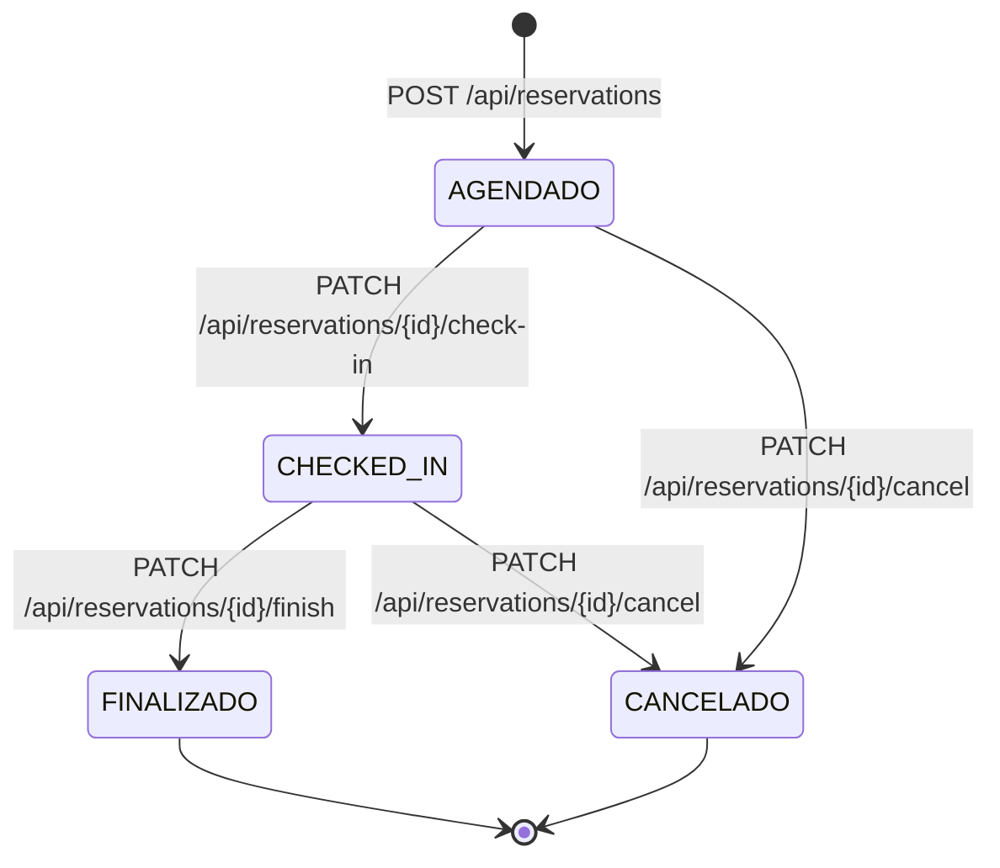

# Especificação da Estrutura e Contratos de API — AlocaNote Backend

Este documento consolida a arquitetura atualizada, contratos de dados, endpoints e enums do projeto [`alocanote-backend`](file:///C:/Users/lanus/Documents/SISTEMAS%20PARA%20INTERNET/5%20SEMESTRE/Programa%C3%A7%C3%A3o%20para%20dispositivos%20m%C3%B3veis/alocanote/alocanote-backend/api), servindo como guia de integração direta para o desenvolvimento do frontend mobile ([`alocanote-app`](file:///C:/Users/lanus/Documents/SISTEMAS%20PARA%20INTERNET/5%20SEMESTRE/Programa%C3%A7%C3%A3o%20para%20dispositivos%20m%C3%B3veis/alocanote/alocanote-app)).

---

## 🌐 Informações de Conexão e Ambiente

| Propriedade | Valor Padrão | Observação |
| :--- | :--- | :--- |
| **Porta do Servidor** | `8082` *(definida em `application.yaml`)* | Certifique-se de configurar a `baseURL` do Axios no mobile para esta porta (ex: `http://10.0.2.2:8082` no emulador Android ou seu IP local no Expo físico). |
| **Prefixo Base** | `/api` | Todos os endpoints partem de `/api`. |
| **Autenticação** | Bearer Token JWT | Header: `Authorization: Bearer <token_jwt>` |
| **Formato de Datas** | ISO-8601 | Exemplo: `"2026-11-10T09:00:00"` |
| **Banco H2 Console** | `http://localhost:8082/h2-console` | JDBC URL: `jdbc:h2:mem:alocanotedb` (User: `sa`, Senha em branco) |

---

## 🗂️ Enums do Domínio

### 1. `Role` (Papéis dos Colaboradores)
Mapeia os cargos dos colaboradores da loja de móveis planejados:
```json
[
  "ADMINISTRADOR",
  "PROJETISTA",
  "CONFERENTE",
  "CONSULTOR_VENDAS",
  "OUTROS"
]
```

### 2. `NotebookStatus` (Estado dos Equipamentos)
Mapeia a disponibilidade dos notebooks:
```json
[
  "DISPONIVEL",
  "EM_USO",
  "MANUTENCAO"
]
```

### 3. `ReservationStatus` (Ciclo de Vida das Reservas)
Controla o fluxo completo do empréstimo de um ativo:
```json
[
  "AGENDADO",
  "CHECKED_IN",
  "CANCELADO",
  "FINALIZADO"
]
```



---

## 📋 Catálogo Completo de Endpoints

### 1. Autenticação & SMS (`/api/auth`)

#### 1.1. Login do Usuário
* **Rota:** `POST /api/auth/login`
* **Acesso:** Público
* **Payload de Envio (`LoginRequestDTO`):**
  ```json
  {
    "email": "maria@alocanote.com",
    "password": "senhaSegura123"
  }
  ```
* **Resposta de Sucesso (HTTP 200 - `LoginResponseDTO`):**
  ```json
  {
    "token": "eyJhbGciOiJIUzI1NiIsInR5cCI6IkpXVCJ9...",
    "type": "Bearer",
    "email": "maria@alocanote.com",
    "name": "Maria Silva",
    "role": "ROLE_USER"
  }
  ```

#### 1.2. Reenvio de SMS (Mock)
* **Rota:** `POST /api/auth/send-sms`
* **Acesso:** Público
* **Payload de Envio (`SendSmsRequestDTO`):**
  ```json
  {
    "phone": "83999998888"
  }
  ```
* **Resposta de Sucesso:** HTTP 200 OK (Sem corpo)

#### 1.3. Validação do Código SMS
* **Rota:** `POST /api/auth/verify-sms` *(ou `POST /auth/verify-sms`)*
* **Acesso:** Público
* **Payload de Envio (`TokenValidationRequestDTO`):**
  ```json
  {
    "phone": "83999998888",
    "code": "123456"
  }
  ```
* **Resposta de Sucesso:** HTTP 200 OK (`"Token validado com sucesso."`)

#### 1.4. Cadastro de Colaborador via Auth
* **Rota:** `POST /api/auth/register` *(ou `POST /auth/register`)*
* **Acesso:** Público
* **Payload de Envio (`RegisterUserRequestDTO`):**
  ```json
  {
    "name": "Helena",
    "email": "helena@alocanote.com",
    "password": "senhaForte123",
    "phone": "5511999999999",
    "role": "PROJETISTA",
    "customRole": null
  }
  ```
* **Resposta de Sucesso:** HTTP 201 Created (`UserResponseDTO`)

---

### 2. Gestão de Usuários e Meu Perfil (`/api/users` ou `/users`)

#### 2.1. Cadastro de Colaborador
* **Rota:** `POST /api/users/register` *(ou `POST /users/register`)*
* **Acesso:** Público
* **Payload de Envio (`RegisterUserRequestDTO`):**
  ```json
  {
    "name": "João Pereira",
    "email": "joao@alocanote.com",
    "password": "senhaForte123",
    "phone": "83988887777",
    "role": "PROJETISTA",
    "customRole": null
  }
  ```
* **Resposta de Sucesso (HTTP 201 Created - `UserResponseDTO`):**
  ```json
  {
    "id": 2,
    "name": "João Pereira",
    "email": "joao@alocanote.com",
    "phone": "83988887777",
    "role": "PROJETISTA",
    "customRole": null,
    "accessLevel": "ROLE_USER",
    "profilePictureUrl": null,
    "street": null,
    "number": null,
    "neighborhood": null,
    "city": null,
    "state": null,
    "zipCode": null,
    "createdAt": "2026-10-17T19:30:00"
  }
  ```

#### 2.2. Obter Meu Perfil (Usuário Autenticado)
* **Rota:** `GET /api/users/me` *(ou `GET /users/me`)*
* **Acesso:** Requer Token JWT
* **Resposta de Sucesso (HTTP 200 OK - `UserResponseDTO`):**
  ```json
  {
    "id": 1,
    "name": "Helena",
    "email": "helena@alocanote.com",
    "phone": "5511999999999",
    "role": "PROJETISTA",
    "customRole": null,
    "accessLevel": "ROLE_USER",
    "profilePictureUrl": "https://...",
    "street": null,
    "number": null,
    "neighborhood": null,
    "city": null,
    "state": null,
    "zipCode": null,
    "createdAt": "2026-10-17T19:30:00"
  }
  ```

#### 2.3. Atualizar Meu Perfil
* **Rota:** `PUT /api/users/me` *(ou `PUT /users/me`)*
* **Acesso:** Requer Token JWT
* **Payload de Envio (`UpdateUserProfileRequestDTO`):**
  ```json
  {
    "name": "Helena Silva",
    "phone": "5511988887777",
    "profilePictureUrl": "https://..."
  }
  ```
* **Resposta de Sucesso (HTTP 200 OK - `UserResponseDTO`)**

#### 2.4. Listar Colaboradores
* **Rota:** `GET /api/users` *(ou `GET /users`)*
* **Acesso:** Requer Token JWT
* **Resposta de Sucesso (HTTP 200 OK - `List<UserResponseDTO>`):**
  ```json
  [
    {
      "id": 1,
      "name": "Administrador do Sistema",
      "email": "admin@alocanote.com",
      "phone": "83999999999",
      "role": "ADMINISTRADOR",
      "customRole": null,
      "accessLevel": "ROLE_ADMIN",
      "profilePictureUrl": null,
      "street": null,
      "number": null,
      "neighborhood": null,
      "city": null,
      "state": null,
      "zipCode": null,
      "createdAt": "2026-10-17T19:00:00"
    }
  ]
  ```

---

### 3. Gestão de Notebooks (`/api/notebooks`)

#### 3.1. Listar Notebooks
* **Rota:** `GET /api/notebooks`
* **Acesso:** Requer Token JWT
* **Resposta de Sucesso (HTTP 200 OK - `List<NotebookResponseDTO>`):**
  ```json
  [
    {
      "id": 1,
      "name": "Notebook 01 - Dell Latitude",
      "modelDescription": "Intel Core i7, 16GB RAM, SSD 512GB",
      "status": "DISPONIVEL"
    },
    {
      "id": 2,
      "name": "Notebook 02 - Dell Vostro",
      "modelDescription": "Intel Core i5, 8GB RAM, SSD 256GB",
      "status": "EM_USO"
    },
    {
      "id": 3,
      "name": "Notebook 03 - Lenovo ThinkPad",
      "modelDescription": "Ryzen 5, 16GB RAM, SSD 512GB",
      "status": "MANUTENCAO"
    }
  ]
  ```

#### 3.2. Detalhes de um Notebook
* **Rota:** `GET /api/notebooks/{id}`
* **Acesso:** Requer Token JWT
* **Resposta de Sucesso (HTTP 200 OK - `NotebookResponseDTO`):**
  ```json
  {
    "id": 1,
    "name": "Notebook 01 - Dell Latitude",
    "modelDescription": "Intel Core i7, 16GB RAM, SSD 512GB",
    "status": "DISPONIVEL"
  }
  ```

#### 3.3. Cadastrar Novo Notebook
* **Rota:** `POST /api/notebooks`
* **Acesso:** Requer Token JWT (Perfil Administrador)
* **Payload de Envio (`CreateNotebookRequestDTO`):**
  ```json
  {
    "name": "Notebook 04 - Asus Zenbook",
    "modelDescription": "Intel Core Ultra 7, 32GB RAM",
    "status": "DISPONIVEL"
  }
  ```
* **Resposta de Sucesso (HTTP 201 Created - `NotebookResponseDTO`):**
  ```json
  {
    "id": 4,
    "name": "Notebook 04 - Asus Zenbook",
    "modelDescription": "Intel Core Ultra 7, 32GB RAM",
    "status": "DISPONIVEL"
  }
  ```

---

### 4. Reservas e Alocações (`/api/reservations`)

#### 4.1. Criar Reserva / Agendamento
* **Rota:** `POST /api/reservations` *(ou `POST /api/reservations/agendar`)*
* **Acesso:** Requer Token JWT
* **Payload de Envio (`CreateReservationRequestDTO`):**
  ```json
  {
    "notebookId": 1,
    "startTime": "2026-11-15T09:00:00",
    "endTime": "2026-11-15T12:00:00",
    "locationId": 1,
    "purpose": "Apresentação de projeto para cliente na loja"
  }
  ```
* **Resposta de Sucesso (HTTP 201 Created - `ReservationResponseDTO`):**
  ```json
  {
    "id": 10,
    "userId": 2,
    "userName": "João Pereira",
    "notebookId": 1,
    "notebookName": "Notebook 01 - Dell Latitude",
    "notebookModel": "Intel Core i7, 16GB RAM, SSD 512GB",
    "startTime": "2026-11-15T09:00:00",
    "endTime": "2026-11-15T12:00:00",
    "locationId": 1,
    "locationName": "Loja Central - João Pessoa",
    "status": "AGENDADO",
    "purpose": "Apresentação de projeto para cliente na loja"
  }
  ```

#### 4.2. Listar Minhas Reservas (Usuário Autenticado)
* **Rota:** `GET /api/reservations`
* **Acesso:** Requer Token JWT
* **Resposta de Sucesso (HTTP 200 OK - `List<ReservationResponseDTO>`):**
  ```json
  [
    {
      "id": 10,
      "userId": 2,
      "userName": "João Pereira",
      "notebookId": 1,
      "notebookName": "Notebook 01 - Dell Latitude",
      "notebookModel": "Intel Core i7, 16GB RAM, SSD 512GB",
      "startTime": "2026-11-15T09:00:00",
      "endTime": "2026-11-15T12:00:00",
      "locationId": 1,
      "locationName": "Loja Central - João Pessoa",
      "status": "AGENDADO",
      "purpose": "Apresentação de projeto para cliente na loja"
    }
  ]
  ```

#### 4.3. Detalhes de Reserva por ID
* **Rota:** `GET /api/reservations/{id}`
* **Acesso:** Requer Token JWT (apenas o titular da reserva)
* **Resposta de Sucesso (HTTP 200 OK - `ReservationResponseDTO`):**
  ```json
  {
    "id": 10,
    "userId": 2,
    "userName": "João Pereira",
    "notebookId": 1,
    "notebookName": "Notebook 01 - Dell Latitude",
    "notebookModel": "Intel Core i7, 16GB RAM, SSD 512GB",
    "startTime": "2026-11-15T09:00:00",
    "endTime": "2026-11-15T12:00:00",
    "locationId": 1,
    "locationName": "Loja Central - João Pessoa",
    "status": "AGENDADO",
    "purpose": "Apresentação de projeto para cliente na loja"
  }
  ```

#### 4.4. Realizar Check-in (Retirada do Equipamento)
* **Rota:** `PATCH /api/reservations/{id}/check-in`
* **Acesso:** Requer Token JWT
* **Ação do Backend:** Altera a reserva para `CHECKED_IN` e o notebook para `EM_USO`.
* **Resposta de Sucesso (HTTP 200 OK - `ReservationResponseDTO`):**
  ```json
  {
    "id": 10,
    "userId": 2,
    "userName": "João Pereira",
    "notebookId": 1,
    "notebookName": "Notebook 01 - Dell Latitude",
    "notebookModel": "Intel Core i7, 16GB RAM, SSD 512GB",
    "startTime": "2026-11-15T09:00:00",
    "endTime": "2026-11-15T12:00:00",
    "locationId": 1,
    "locationName": "Loja Central - João Pessoa",
    "status": "CHECKED_IN",
    "purpose": "Apresentação de projeto para cliente na loja"
  }
  ```

#### 4.5. Cancelar Reserva
* **Rota:** `PATCH /api/reservations/{id}/cancel`
* **Acesso:** Requer Token JWT
* **Ação do Backend:** Altera a reserva para `CANCELADO` e libera o notebook para `DISPONIVEL`.
* **Resposta de Sucesso (HTTP 200 OK - `ReservationResponseDTO`):**
  ```json
  {
    "id": 10,
    "userId": 2,
    "userName": "João Pereira",
    "notebookId": 1,
    "notebookName": "Notebook 01 - Dell Latitude",
    "notebookModel": "Intel Core i7, 16GB RAM, SSD 512GB",
    "startTime": "2026-11-15T09:00:00",
    "endTime": "2026-11-15T12:00:00",
    "locationId": 1,
    "locationName": "Loja Central - João Pessoa",
    "status": "CANCELADO",
    "purpose": "Apresentação de projeto para cliente na loja"
  }
  ```

#### 4.6. Finalizar Reserva (Devolução do Equipamento)
* **Rota:** `PATCH /api/reservations/{id}/finish` *(ou `/check-out`)*
* **Acesso:** Requer Token JWT
* **Ação do Backend:** Altera a reserva para `FINALIZADO` e restaura o status do notebook para `DISPONIVEL`.
* **Resposta de Sucesso (HTTP 200 OK - `ReservationResponseDTO`):**
  ```json
  {
    "id": 10,
    "userId": 2,
    "userName": "João Pereira",
    "notebookId": 1,
    "notebookName": "Notebook 01 - Dell Latitude",
    "notebookModel": "Intel Core i7, 16GB RAM, SSD 512GB",
    "startTime": "2026-11-15T09:00:00",
    "endTime": "2026-11-15T12:00:00",
    "locationId": 1,
    "locationName": "Loja Central - João Pessoa",
    "status": "FINALIZADO",
    "purpose": "Apresentação de projeto para cliente na loja"
  }
  ```

#### 4.7. Consultar Ocupação no Calendário
* **Rota:** `GET /api/reservations/calendar?month=11&year=2026` *(ou `GET /reservations/calendar?month=11&year=2026`)*
* **Acesso:** Requer Token JWT
* **Ação do Backend:** Retorna todas as reservas ativas (`AGENDADO` e `CHECKED_IN`) do período especificado para exibição no calendário geral de ocupação.
* **Resposta de Sucesso (HTTP 200 OK - `List<ReservationResponseDTO>`)**

---

### 5. Locais de Retirada (`/api/locations`)

#### 5.1. Listar Locais
* **Rota:** `GET /api/locations`
* **Acesso:** Requer Token JWT
* **Resposta de Sucesso (HTTP 200 OK - `List<LocationResponseDTO>`):**
  ```json
  [
    {
      "id": 1,
      "name": "Loja Central - João Pessoa",
      "address": "Av. Epitácio Pessoa, 1200 - Tambaú",
      "cep": "58039-000"
    }
  ]
  ```

#### 5.2. Buscar Local por CEP
* **Rota:** `GET /api/locations/cep/{cep}`
* **Acesso:** Requer Token JWT
* **Resposta de Sucesso (HTTP 200 OK - `LocationResponseDTO`):**
  ```json
  {
    "id": 1,
    "name": "Loja Central - João Pessoa",
    "address": "Av. Epitácio Pessoa, 1200 - Tambaú",
    "cep": "58039000"
  }
  ```

---

## ⚠️ Padrão de Resposta de Erro (`StandardError`)

Sempre que uma regra de negócio for violada (HTTP 400) ou um registro não for encontrado (HTTP 404), o backend responde com o seguinte formato JSON:

```json
{
  "timestamp": "2026-10-17T19:35:10.123456",
  "status": 400,
  "error": "Operação Inválida",
  "message": "Este notebook já possui um agendamento conflitante para este intervalo de horário."
}
```

### Principais Mensagens de Erro Retornadas:
| Cenário | Status HTTP | Mensagem (`message`) |
| :--- | :--- | :--- |
| **Data final <= inicial** | 400 Bad Request | `"A data de término deve ser posterior à data de início."` |
| **Notebook em manutenção** | 400 Bad Request | `"Este notebook está em manutenção e não pode ser reservado."` |
| **Conflito de horário** | 400 Bad Request | `"Este notebook já possui um agendamento conflitante para este intervalo de horário."` |
| **Check-in inválido** | 400 Bad Request | `"Só é possível fazer check-in de reservas com status AGENDADO."` |
| **Finalizar sem check-in** | 400 Bad Request | `"Só é possível finalizar reservas que estejam em andamento (CHECKED_IN)."` |
| **Reserva já encerrada** | 400 Bad Request | `"Esta reserva já foi finalizada ou cancelada."` |
| **Acesso negado de recurso** | 400 Bad Request | `"Acesso negado: esta reserva pertence a outro usuário."` |
| **E-mail ou telefone duplicado**| 400 Bad Request | `"Já existe um usuário cadastrado com este e-mail."` / `"telefone"` |
| **Não encontrado** | 404 Not Found | `"Notebook não encontrado com o ID: {id}"` / `"Reserva não encontrada..."` |

---

## 📱 Guia Rápido de Sincronização para o Frontend Mobile

1. **Tipagens TypeScript (`src/types/index.ts`):** Espelhe os 3 enums (`Role`, `NotebookStatus`, `ReservationStatus`) com os mesmos literais de string em maiúsculas.
2. **Serviço de API (`src/services/api.ts`):**
   - Configurar Axios com `baseURL: 'http://<IP_OU_HOST>:8082/api'`.
   - Adicionar interceptor para injetar o header `Authorization: Bearer ${token}` salvo no AsyncStorage/SecureStore.
3. **Fluxo de Reserva nas Telas:**
   - Na tela de nova reserva: listar notebooks via `GET /api/notebooks` (filtrando por `status === 'DISPONIVEL'`) e locais via `GET /api/locations`.
   - Na tela "Minhas Reservas": consumir `GET /api/reservations`.
   - Nos botões de ação:
     - Se `status === 'AGENDADO'`: exibir botões "Fazer Check-in" (`PATCH /api/reservations/{id}/check-in`) e "Cancelar" (`PATCH /api/reservations/{id}/cancel`).
     - Se `status === 'CHECKED_IN'`: exibir botão "Devolver / Finalizar" (`PATCH /api/reservations/{id}/finish`).
     - Se `FINALIZADO` ou `CANCELADO`: apenas exibir histórico/badge informativo sem botões de alteração.
